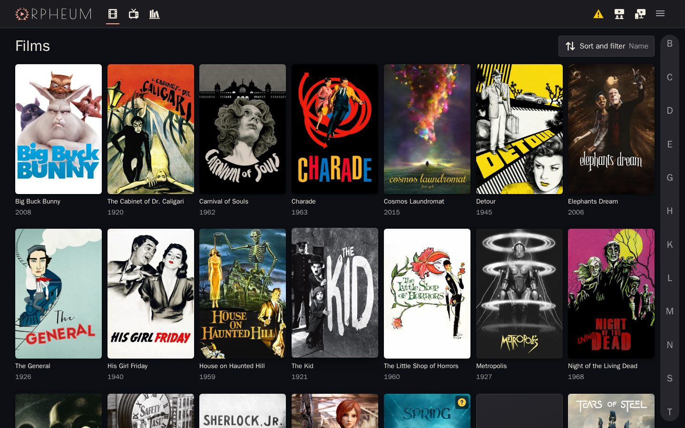
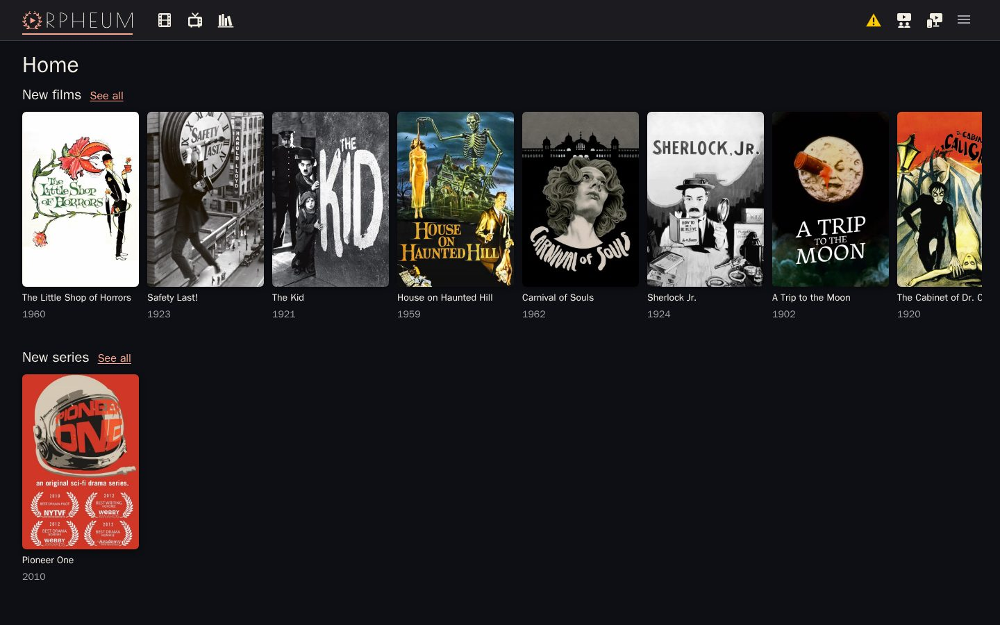
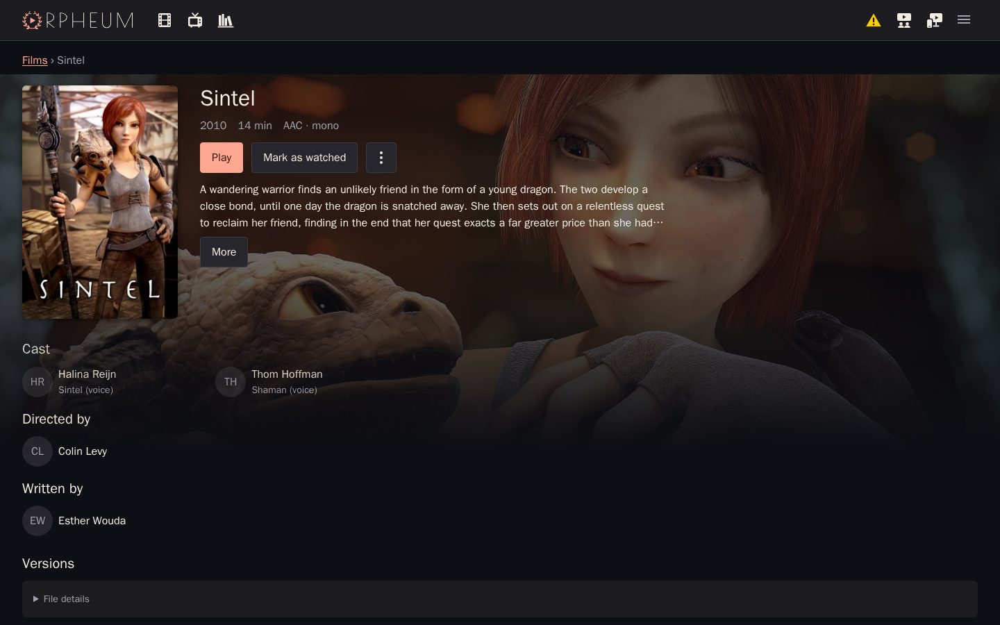
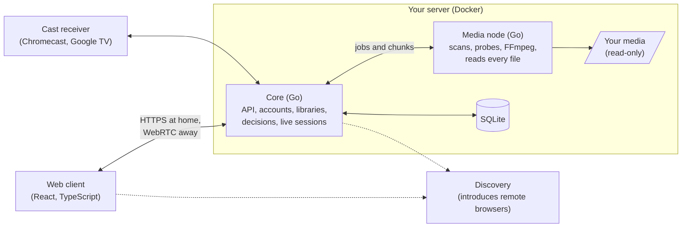

# Orpheum

A self-hosted media server for your own films and series.

- Your own hardware.
- Your own videos.
- Play from anywhere.

----

> **Status: closed beta.** Orpheum runs every day in its owner's home, beside a staging server
> that every change reaches first, but it is not ready for general use: expect rough edges, missing features and
> breaking changes.

----

<table><tr>
<td></td>
<td></td>
</tr></table>

Screenshots from the development server's demo library: short generated clips named for
public-domain and Creative Commons films, with posters and details from
<a href="https://www.themoviedb.org/">TMDB</a>. This product uses the TMDB API but is not
endorsed or certified by TMDB.

## Features

- **Watch from anywhere.** No need to open ports. No VPN required.
- **Hardware transcoding.** Intel Quick Sync, VA-API, NVIDIA NVENC, or via CPU when a GPU is unavailable.
- **Subtitles that work.** Embedded or fetched, with full font and placement support.
- **Watch Together.** Multiple people can watch a film together from anywhere in the world, and optionally chat voice.
- **Casting.** Send playback video to other devices like TVs, optionally using your phone as a remote.
- **Dialogue boost and loudness leveling.** Now you can hear what people are saying, and not get blasted when switching to another film.
- **Posters & artwork.** Matches your media with TMDB for posters and details, and episode orderings.
- **Safety first.** Every part that takes in data from files or from 3rd party sites is isolated, sandboxed, and cannot write.
- **Accounts and invitations.** As many as you want, with each person's own watch state and settings.
- **Easy deployment.** It's a single go binary, with quick deployment available via Docker.
- **Your data stays yours.** Rebuildable database. Metadata can be written back as NFO files.

## What it's for

Orpheum is a player for media you have the right to use. It does not provide, locate or download content,
and it does not bypass copy protection. You are responsible for complying with copyright law
where you live, including when you share access with others.

## The promise

- **No telemetry.**
- **No storefront.**
- **No restrictions.**
- **No paywall.**
- **No ads.**

## Install

Orpheum runs on any Linux machine with Docker, including NAS systems such as OpenMediaVault. See
**[docs/users/install.md](docs/users/install.md)**, and
[setup-problems.md](docs/users/setup-problems.md) when something goes wrong.

To develop it, you need only Docker: `./dev make dev` builds the development image and starts a
server with a demo library ([CONTRIBUTING.md](CONTRIBUTING.md)).

## Architecture

The **core** never opens a media file and never runs FFmpeg; the **media node** does both, inside
a sandbox, because media files are hostile input. Package by package, with what each owns and the
tests that keep it so: [`docs/contributors/design/architecture-map.md`](docs/contributors/design/architecture-map.md).

| Part | Stack |
| --- | --- |
| Server and media node | Go, SQLite (sqlc, append-only migrations), FFmpeg, Landlock confinement |
| Clients | TypeScript, React, Vite, hls.js, libass (WebAssembly), Vitest, Playwright |
| Remote access | WebRTC (pion), a hosted discovery service, TURN |
| Operations | Docker images, GitHub Actions, a staging server, automatic backups |
| Engineering gates | Python checks, golangci-lint, ESLint, architecture tests, revert-red |

## Licence

**Server, media node and relay: AGPLv3. Clients and the shared SDK: MPL-2.0.** The split is
deliberate: a GPL-family application cannot be distributed through Apple's App Store, so the
clients are MPL-2.0, whose copyleft is per file
Contributions are accepted under the [CLA](CLA.md).
