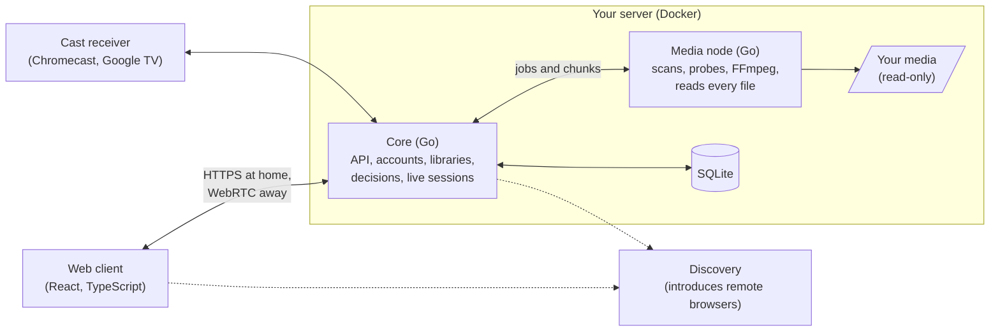

# Orpheum

A self-hosted media server for **video**: your films and series, on your own hardware, played in
a browser, on a television or cast to one, with no company between you and your files.

> **Status: closed beta.** Orpheum runs every day in its owner's home, beside a staging server
> that every change reaches first, but it is not ready for general use: expect rough edges, missing features and
> breaking changes. *(The name is provisional, [D195](docs/contributors/decisions/working-notes.md).)*

**Built with AI.** Nearly every line of this repository (the Go server, the React clients, the
container builds, the deployment, the gates that check them, and the documentation) was
written by Claude agents, directed and reviewed by one engineer. How that was made to work
reliably is told in **[How Orpheum was built](docs/how-it-was-built.md)**.

## What it does

- **Plays what you have, the way it is.** Direct play is the default: the server hands over the
  original bytes when the device can play them. The client, not a server-side device database,
  decides what it can play, by asking its own decoder.
- **Transcodes when it must,** in chunks prepared ahead of the viewer, on the GPU when there is
  one (Intel Quick Sync, VA-API, NVIDIA NVENC), on the CPU when there is not.
- **Subtitles that work:** extracted at scan time with their embedded fonts and rendered with
  libass, so styled anime subtitles look as their authors meant; missing ones fetched from
  OpenSubtitles.
- **Watch Together:** a session that keeps several people's players in step, at home or across
  the internet.
- **Casting** to Chromecast and Google TV with its own receiver app, and a television interface
  driven by a remote.
- **Libraries** scanned from your folders, matched against TMDB for posters and details, with
  episode orderings, resume points and per-user watch state.
- **Remote access without opening ports:** browsers away from home reach the server over WebRTC,
  introduced by a small discovery service; nothing in the middle can read the stream.
- **Your files stay yours:** media is mounted read-only, the database is a rebuildable index, and
  everything that cannot be re-derived is backed up automatically.
- **Accounts and invitations** for the household, with each person's own watch state and settings.

## Architecture

The **core** never opens a media file and never runs FFmpeg; the **media node** does both, inside
a sandbox, because media files are hostile input. Package by package, with what each owns and the
tests that keep it so: [`docs/contributors/design/architecture-map.md`](docs/contributors/design/architecture-map.md).

| Part | Stack |
| --- | --- |
| Server and media node | Go, SQLite (sqlc, append-only migrations), FFmpeg, Landlock confinement |
| Clients | TypeScript, React, Vite, hls.js, libass (WebAssembly), Vitest, Playwright |
| Remote access | WebRTC (pion), a hosted discovery service, TURN |
| Operations | Docker images, GitHub Actions, a staging server, automatic backups |
| Engineering gates | Python checks, golangci-lint, ESLint, architecture tests, revert-red |

## Install

Orpheum runs on any Linux machine with Docker, including NAS systems such as OpenMediaVault. See
**[docs/users/install.md](docs/users/install.md)**, and
[setup-problems.md](docs/users/setup-problems.md) when something goes wrong.

To develop it, you need only Docker: `./dev make dev` builds the development image and starts a
server with a demo library ([CONTRIBUTING.md](CONTRIBUTING.md)).

## By the numbers

| | |
| --- | --- |
| Built | 7 weeks, from 2026-09-17, about 3,700 commits |
| Code | about 276,000 lines of Go and 186,000 of TypeScript, tests included |
| Tests | about 2,700 Go tests, 2,700 web tests, 670 tests of the gates themselves |
| Decisions | 446, each recorded with its reasoning ([index](docs/contributors/decisions/index.md)) |

## What it is for

A player for media you have the right to use. It does not provide, locate or download content,
and it does not remove copy protection. You are responsible for complying with copyright law
where you live, including when you share access with others.

## The promise

- **No telemetry, no storefront, no ads.**
- **Your files stay yours:** read-only by default, a trash you can undo from if you grant write
  access, and an automatic backup of everything that cannot be re-derived
  ([D98](docs/contributors/decisions/working-notes.md), [D141](docs/contributors/decisions/working-notes.md)).
- **Nothing that runs on your own hardware will ever be put behind a payment.** Only what
  genuinely needs another machine, such as introducing remote browsers, could ever cost money,
  and you can run that part yourself ([D25](docs/contributors/decisions/working-notes.md)).

## Licence

**Server, media node and relay: AGPLv3. Clients and the shared SDK: MPL-2.0.** The split is
deliberate: a GPL-family application cannot be distributed through Apple's App Store, so the
clients are MPL-2.0, whose copyleft is per file
([D80](docs/contributors/decisions/working-notes.md), [D275](docs/contributors/decisions/working-notes.md)).
Contributions are accepted under the [CLA](CLA.md).

## Documentation

- [`docs/how-it-was-built.md`](docs/how-it-was-built.md): the AI-driven process, and the files
  that show it.
- [`AGENTS.md`](AGENTS.md): the contract every agent changing the code follows.
- [`docs/contributors/`](docs/contributors/README.md): design, decisions, standards and principles.
- [`docs/FEATURES.md`](docs/FEATURES.md): every feature considered, ranked, including the declined
  ones and why.
